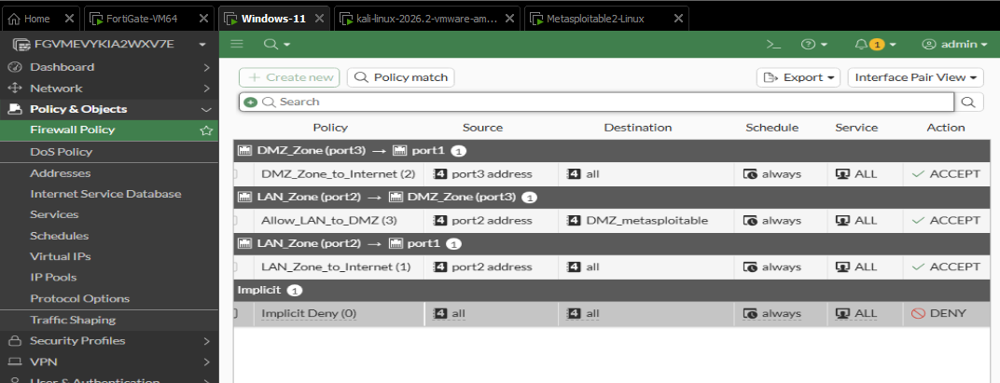
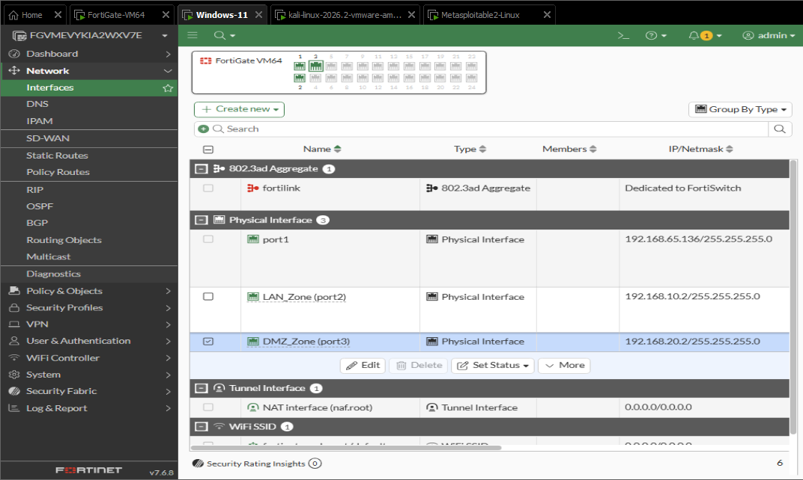
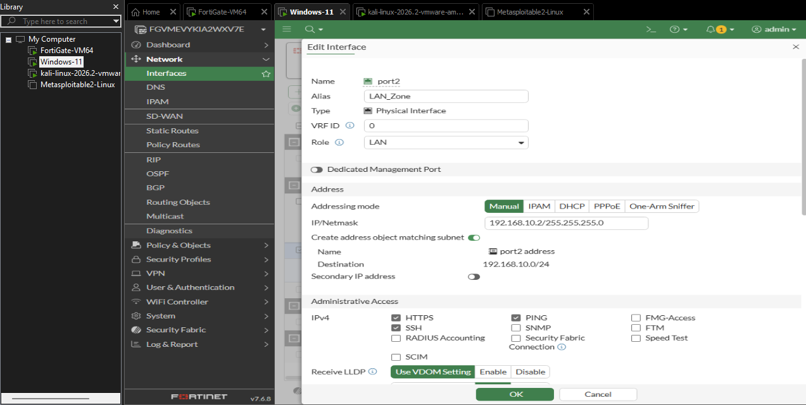
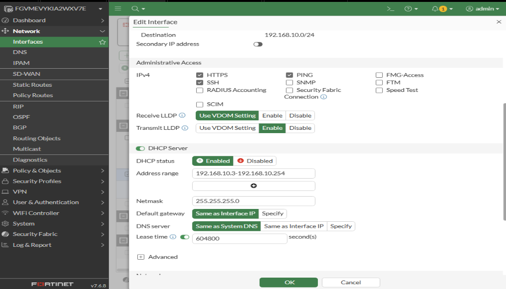
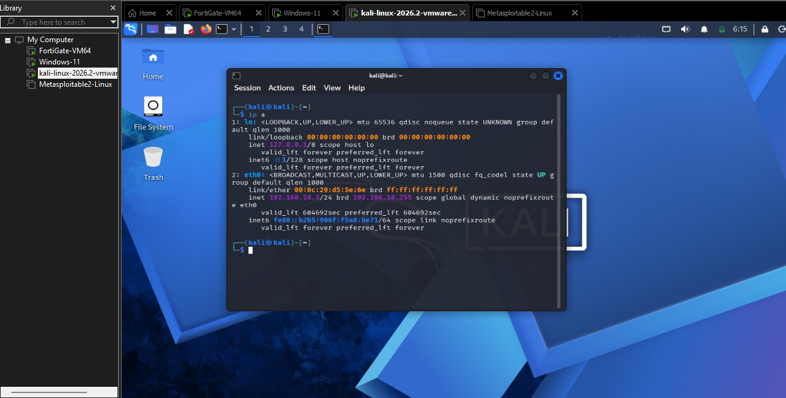
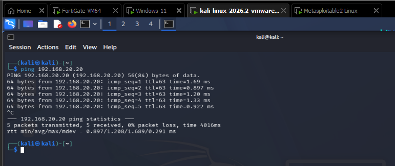
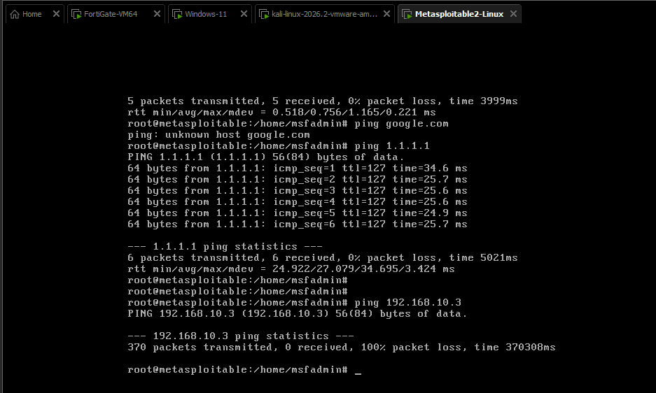

# FortiGate DMZ Segmentation & Stateful Firewall Lab

## Overview

This project demonstrates the deployment of a **FortiGate Next-Generation Firewall (NGFW)** in a virtualized enterprise environment. 

The core objective was to simulate a secure network architecture by isolating a high-risk public-facing server (DMZ) from the internal corporate network (LAN). By configuring isolated virtual switches (VMnets) and strict stateful firewall policies, the lab proves how to successfully prevent **lateral movement** in the event of a server compromise, while still allowing authorized internal traffic and safe internet access.

## Network Architecture & Topology

The lab consists of three distinct network zones mapped to separate FortiGate interfaces:
*   **WAN (port1):** `192.168.65.136/24` (Simulated Internet access)
*   **LAN_Zone (port2):** `192.168.10.2/24` (Internal Network, DHCP enabled)
*   **DMZ_Zone (port3):** `192.168.20.2/24` (Public-facing Servers)

**Virtual Machines Used:**
*   **Kali Linux:** Connected to the LAN network to act as an internal corporate workstation.
*   **Metasploitable:** Connected to the DMZ network to act as a vulnerable public server.

## Core Configurations & Security Logic

### 1. Network Segmentation (The VMnets & Interfaces)
*   **What I did:** I mapped the Kali Linux PC to `port2` (LAN) and the Metasploitable machine to `port3` (DMZ) using completely isolated virtual switches in VMware.
*   **Why I did it:** If both machines were plugged into the same network segment, they would talk to each other directly via Layer 2 MAC addresses. Traffic would never go up to the FortiGate, rendering the firewall blind. Forcing them onto separate VMnets ensures all data packets must hit the FortiGate gateway to be routed.
*   **Real-World Benefit:** In a company, you never mix internal employee laptops with public-facing servers. If a web server is hacked, segmenting it prevents the hacker from instantly scanning the local network to find the CEO’s laptop or HR payroll servers. This is called **preventing lateral movement**.

### 2. State-Based Access Control Policies (The Firewall Rules)
*   **What I did:** I created a policy explicitly allowing traffic from `LAN_Zone` to `DMZ_Zone`. I created absolutely **no policy** allowing traffic to initiate from the DMZ back to the LAN.
*   **Why I did it:** FortiGate operates on strict **Implicit Deny** and **Stateful Inspection**. Because the firewall tracks the "state" of a connection, when the LAN PC pings the DMZ, the FortiGate remembers that session and automatically allows the reply back through. However, if the DMZ server tries to start a *brand new* connection toward the LAN, the firewall checks its rule base, finds no matching policy, and drops it instantly.
*   **Real-World Benefit:** If an attacker compromises the DMZ web server, they are trapped in an isolated sandbox. They cannot scan the internal office network or compromise corporate devices because the firewall blocks all uninitiated outbound DMZ traffic.

### 3. Network Address Translation (NAT) Routing
*   **What I did:** When configuring internal traffic between LAN and DMZ, I **disabled NAT**. When configuring internet access from LAN/DMZ out to the WAN (port1), I **enabled NAT**.
*   **Why I did it:** 
    *   *Inside the Network:* Disabling NAT internally ensures that when the Linux PC talks to Metasploitable, the server sees the actual real IP address of the Linux machine. This is crucial for accurate logging and security tracking.
    *   *Going to the Internet:* Private IP addresses are unroutable on the public internet. Enabling NAT tells the FortiGate to strip the private IP and mask it behind its own public-facing WAN IP.
*   **Real-World Benefit:** Enterprises might have 5,000 internal PCs but only a few public IP addresses from their ISP. NAT (PAT) allows thousands of devices to safely browse the internet using one public IP, while hiding the internal network structure from external attackers.

---

## Verification & Evidence

### 1. Firewall Policy Matrix
Notice the strict rules. LAN can talk to DMZ and Internet. DMZ can only talk to the Internet. The default rule at the bottom is **Implicit Deny**.

### 2. Interface & Zone Configuration
Interfaces are bound to specific roles (LAN, DMZ, WAN).

### 3. LAN to DMZ Connectivity (Success)
The Kali Linux machine (LAN) successfully obtains an IP via DHCP and can ping the Metasploitable server in the DMZ.
*   **Kali IP:** `192.168.10.3`

*   **Ping Success:** `ping 192.168.20.20`

### 4. DMZ to LAN Blocked (Stateful Firewall Proof)
The Metasploitable machine (DMZ) can reach the internet (`1.1.1.1`), proving NAT and outbound routing work. However, when it tries to ping the Kali machine (`192.168.10.3`), it suffers **100% packet loss**, proving the stateful firewall is protecting the LAN from uninitiated inbound connections.

---

## Lessons Learned

- **The Importance of VMnets:** Learning to properly isolate virtual interfaces in VMware is critical for firewall labs. If interfaces share a VMnet, bypassing the firewall entirely is easy.
- **Stateful vs. Stateless:** I gained a deep appreciation for stateful inspection. It allows internal users to browse the web without needing a specific rule to allow the return traffic, while still keeping the network secure.
- **NAT Boundaries:** Disabling NAT internally was a key takeaway. It ensures visibility into the true source of traffic, which is essential for forensic analysis and IDS/IPS monitoring.

## Author

**Mumbere Espoir**
*   Focused on Network Security, Firewalls, and Infrastructure Hardening

---
*Disclaimer: This project was built in an isolated virtual lab for educational and defensive security purposes only.*
